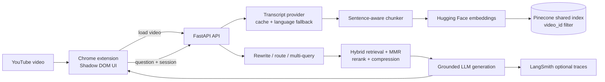

# YouTube Transcript RAG Chatbot

A modular, transcript-grounded RAG backend and Chrome extension for asking questions about the YouTube video currently being watched. The assistant indexes one shared Pinecone index, isolates every query with `video_id` metadata, returns structured timestamps, and never treats transcript text as instructions.

## Architecture



## Project layout

```text
backend/
  api/                 FastAPI request/response models and routes
  ingestion/           URL parsing, provider abstraction, cache, chunking
  indexing/            Hugging Face embedding and Pinecone adapters
  retrieval/           rewrite, route, multi-query, hybrid, MMR, rerank, compression
  generation/          prompts, grounding guardrails, answer/citation assembly
  memory/              video-scoped session memory
  evaluation/          RAGAS and LangSmith integrations
  app.py               FastAPI entry point
  service.py           orchestration layer
frontend/chrome-extension/
  chat.html            floating panel markup
  chat.css             isolated panel styles
  content.js           YouTube-page behavior and timestamp seeking
  background.js        backend requests
eval/                  editable RAGAS questions, answers, and results
tests/                 fast unit/API tests plus an opt-in public-video test
RAG_sys.ipynb          original experimentation notebook, now security-cleaned
```

## Setup

Use Python 3.10 or later. From the project root:

```powershell
python -m venv .venv
.\.venv\Scripts\Activate.ps1
pip install -r requirements.txt
Copy-Item .env.example .env
```

Set the following in `.env`; do not put a token in Python or notebook source.

| Variable | Required | Purpose |
| --- | --- | --- |
| `HF_TOKEN` | Yes for embedding/generation | Hugging Face inference access |
| `PINECONE_API_KEY` | Yes for indexing/querying | Pinecone access |
| `PINECONE_INDEX` | Yes | Reused shared index name |
| `PINECONE_CLOUD`, `PINECONE_REGION` | Yes | Serverless index location |
| `PINECONE_NAMESPACE` | No | Logical transcript collection |
| `LANGSMITH_API_KEY` | Optional | Trace export |
| `LANGSMITH_TRACING` | Optional | Set `true` to enable trace export |
| `LANGSMITH_PROJECT` | Optional | LangSmith project name |

Create a Pinecone project/key first; the API creates the named serverless cosine index when the first video is loaded. Use an HF token authorized for the configured embedding and LLM models. Set `LANGSMITH_TRACING=true` only after supplying `LANGSMITH_API_KEY`.

Start the backend:

```powershell
uvicorn backend.app:app --reload --port 8000
```

Confirm `http://127.0.0.1:8000/api/health` reports `status: ok`. A missing credential is reported as a safe setup error when a dependent endpoint is used; values and stack traces are never returned to the extension.

## Load the Chrome extension

1. Open `chrome://extensions` and enable Developer mode.
2. Choose **Load unpacked** and select `frontend/chrome-extension`.
3. Open any supported YouTube video and select the red chat button at the top-right.
4. The extension indexes that video the first time its panel is opened. Ask a question after indexing completes.

The extension uses `chat.html` and `chat.css` inside a Shadow DOM, so its styles do not alter YouTube. Enter sends a message; Shift+Enter adds a line. Citation buttons seek the YouTube player to their structured source timestamp. Configure a different local backend through the extension's Options page; the manifest is intentionally restricted to localhost by default.

## Request flow

1. The extension reads the current YouTube video ID and title.
2. `POST /api/video/load` validates the URL/ID, loads cached captions or calls the transcript provider with Hindi then English fallback, and classifies blocked/unavailable cases.
3. The chunker creates timestamp-preserving, sentence-aware overlapping chunks. A content hash prevents re-indexing unchanged videos.
4. Vectors are saved to the shared Pinecone index with `video_id` metadata. Changed transcripts replace only that video's records.
5. `POST /api/chat` scopes memory by `(session_id, video_id)`, rewrites follow-ups, routes the question, generates alternate retrieval queries where useful, and filters Pinecone candidates to the current video.
6. Dense candidates receive lexical blending, reranking, MMR diversity selection, and contextual compression.
7. The generator receives only delimited transcript evidence. The response returns answer text plus structured `sources`; the UI renders the timestamps as seek controls.

Simple factual questions do not use an agent loop. The split interfaces (`TranscriptProvider`, `EmbeddingProvider`, `VectorStore`, reranker, generator) leave room for future frame, OCR, chart, or slide retrieval without changing the chat contract.

## API examples

```http
POST /api/video/load
Content-Type: application/json

{
  "video_url": "https://www.youtube.com/watch?v=dQw4w9WgXcQ",
  "title": "Example video"
}
```

```json
{
  "video_id": "dQw4w9WgXcQ",
  "title": "Example video",
  "chunks_indexed": 31,
  "reused": false
}
```

```http
POST /api/chat
Content-Type: application/json

{
  "video_id": "dQw4w9WgXcQ",
  "question": "Why is the approach important?",
  "session_id": "browser-session-id",
  "video_title": "Example video"
}
```

```json
{
  "answer": "The speaker explains that ...",
  "sources": [
    {
      "video_id": "dQw4w9WgXcQ",
      "start_time": 151.0,
      "end_time": 174.0,
      "text": "Relevant transcript excerpt"
    }
  ],
  "video_id": "dQw4w9WgXcQ",
  "session_id": "browser-session-id",
  "retrieval_info": {
    "strategy": "conceptual_explanation",
    "num_candidates": 12,
    "queries": ["Why is the approach important?"],
    "latency_ms": 84
  }
}
```

## Evaluation and observability

Edit `eval/questions.json` with video IDs/questions and `eval/answers.json` with human-reviewed references, retrieved contexts, and generated answers collected from a run. Then execute:

```powershell
python eval/evaluate.py
```

The runner calculates RAGAS faithfulness, answer relevancy, context precision, and context recall, storing timestamped JSON in `eval/results/`. The provided examples are templates and intentionally do not call a real video. LangSmith records ingestion, retrieval, and generation latency/error/output-shape traces when enabled through environment variables.

## Testing

```powershell
pytest -q
```

The default suite covers YouTube URL forms, chunk timestamps/content hashes, video-scoped memory, routing, prompt-injection guardrails, API-safe errors, and structured citations using fakes. `tests/test_e2e_public_video.py` is skipped unless `YOUTUBE_E2E_VIDEO_URL` is explicitly supplied; a full live run also needs valid external credentials.

Install development test dependencies with `pip install -r requirements-dev.txt`. RAGAS, datasets, and the optional cross-encoder reranker are intentionally separate in `requirements-evaluation.txt` so the chatbot can start quickly without the heavier evaluation stack.

## Troubleshooting

- `youtube_request_blocked`: YouTube is refusing transcript requests from the server IP. Wait and retry; do not add cookies or account automation to the extension.
- `transcript_unavailable`: captions are disabled or unavailable in Hindi/English. The provider preserves a clear extension-safe error.
- `service_not_configured`: set the missing `HF_TOKEN` or `PINECONE_API_KEY` in `.env`, then restart Uvicorn.
- Pinecone index errors: verify the index/cloud/region values and that the API key has project access.
- No answer with sources: the retriever found no suitable context. The answer intentionally says the transcript lacks enough information.

## Security note

The previous notebook included a hardcoded Hugging Face token. It has been removed from source and `.env` is ignored. Revoke or rotate that token in Hugging Face immediately, then place the replacement only in your local `.env`.
